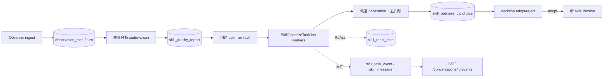

# Feature：Skill 质量报告与优化流水线（简版）

> 范围：质量报告（九维评分）、优化流水线（五门禁 / ReAct）、分析优化工作台（SSE 会话）。
> 端点与表名速查见 [api-reference-skillhub-extended.md](api-reference-skillhub-extended.md)；差距背景见 [skill-feature-gap-and-alignment-plan.md](skill-feature-gap-and-alignment-plan.md)。

## 1. 用户流程

```text
观测数据（Observer 上传）
  → 打开 /observe/:slug → 质量 Tab → 触发/查看质量报告
  → 发起优化任务（/analyze-optimize 工作台，或直接 POST optimize-tasks）
  → 后台生成候选 + 五门禁（stepwise 可在工作台 advance 断点续跑）
  → 工作台查看候选 diff / ReAct 轨迹 → 采纳（adopt）或驳回（reject）
  → 采纳后生成新版本，观测与质量报告继续迭代
```

要点：

1. **质量报告**：在观测技能详情的质量 Tab（`QualityReportPanel`）查看 `overallScore` 与各维度明细；无数据时展示降级骨架。可按 `scope=static|chain|all` 触发重算。
2. **优化任务**：工作台（`/analyze-optimize`，`SkillWorkbenchPage`）绑定 Skill@版本创建会话；`runMode=auto` 后台自动跑，`runMode=stepwise` 在 `waiting_input` 暂停，用户经会话 `advance`（可带 `note`）继续。
3. **决策**：任务到 `pending_review` 后，消息流中的候选卡 / 候选抽屉展示 diff 与门禁结果；`adopt` 发布为新版本，`reject` 关闭任务。
4. **可观测**：ReAct 步骤实时写入 `skill_react_step`，ReactTraceDrawer 按 `after` 游标增量拉取。

## 2. 端到端数据流



流程拆解：

| 阶段 | 主要表 / 端点 |
| --- | --- |
| 观测 | `observation_session` / `observation_turn` / `observation_step`（`POST /api/observations/ingest`） |
| 质量 | `skill_quality_report`、`skill_quality_config`（`GET/POST .../quality-report*`） |
| 优化任务 | `skill_optimize_task`（`POST .../skills/{slug}/optimize-tasks`） |
| 候选 + 门禁 | `skill_optimize_candidate`（`SkillOptimizeGate`：improvement / regression / tests / budget / paired） |
| ReAct 轨迹 | `skill_react_step`、`skill_react_staging`（`GET .../optimize-tasks/{id}/react-steps`） |
| 会话投影 | `skill_conversation`、`skill_message`、`skill_task_event`（SSE 加速，DB 为准） |
| 决策 | `POST .../optimize-candidates/{id}/decision` → 新版本 / 驳回 |

## 3. 依赖

- **LLM**：评分链路与候选生成统一走 `AnalysisModelClient`。运行时配置在 `sys_ai_config`（`/api/ai-config` GET/PUT 热更新）；`application.yml` 的 `skillhub.analysis.llm.*` 仅作初始 fallback。未配置 endpoint 时相关能力降级或报 `AI_CONFIG_ERROR`。
- **后台执行**：`skillhub.optimize.workers`（默认 2）与 `worker-delay-ms`（默认 5000）驱动 `SkillOptimizeTaskJob`。
- **数据库**：Flyway V12-V17（质量/优化/会话/ReAct/摘要/AI 配置）。

## 4. 已知限制 / 后续项（T30）

- job 过程事件目前仅 `advance` 全量投影到会话消息，其余阶段事件未全部投影到 `skill_message`。
- 优化候选「生成 → 门禁 → 采纳发布新版本」的全生命周期需配置真实 LLM 才能端到端跑通。
- 工作台 `POST /conversations/{id}/messages` 仅落库，尚未实现对话式 LLM 应答。
- Job 相关测试在共享测试库下的隔离性仍可改进。
