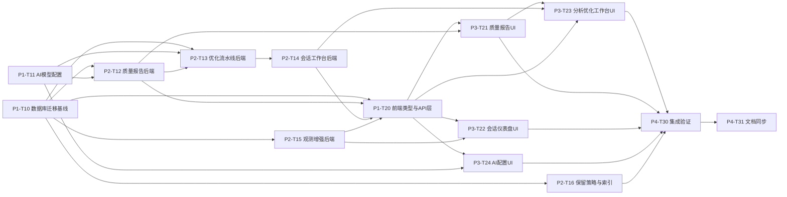

# SkillHub 功能差距与对齐实施方案

> 对比对象：
> - **源**：`D:\program\kmplm-development-process`（研发效能管理平台，下文简称 **kmplm**）
> - **目标**：`D:\program\skill-hub-simple`（当前仓库 SkillHub，下文简称 **simple**）
>
> 目标：列出 kmplm 中 skill 相关而 simple 尚缺的功能，并给出可拆分子 agent 执行的对齐实施方案。
>
> 生成日期：2026-06-11

---

## 一、结论速览

两仓库的 SkillHub 同源（CLI 命令集几乎一致，`/api/skills`、`/api/discovery`、观测 ingest 与基础分析已对齐）。**差距集中在五个新能力域**，全部位于后端扩展 API + 对应前端页面，另有少量数据库与工程配套差异：

| # | 差距域 | 严重度 | simple 现状 |
| --- | --- | --- | --- |
| G1 | Skill 质量报告（九维评分 + LLM 分析） | 高 | 仅有观测行为指标（errorRate/reloadRate/checklistCoverage），无结构化质量报告 |
| G2 | Skill 优化流水线（optimize task / candidate / 五门禁 / ReAct 轨迹） | 高 | 完全没有 |
| G3 | 分析优化工作台（SSE 会话、分步推进、前端 workbench 页面） | 高 | 完全没有 |
| G4 | 观测会话 dashboard / 节点详情 / 全文检索 / 预聚合 | 中 | 有链路树 + 指标面板 + 分析面板，缺 dashboard 多视图、会话检索、读取预聚合 |
| G5 | AI 模型运行时配置（sys_ai_config） | 中 | LLM 参数仅在 `application.yml` 静态配置，无管理端点与 UI |
| G6 | 工程配套（feature 文档、测试基线） | 低 | 文档仅 2 篇；测试有但覆盖面待核 |

> **反向说明（simple 不缺甚至更优的部分）**：CLI `uninstall <slug...>`（卸载本地技能）simple 有而 kmplm 的 `uninstall` 仅卸 CLI 自身；discovery 数据模型（stars/trend/quality/trust/sync_log）两边一致；观测 ingest 幂等、契约分析（contract/conflicts/paths/analyze jobs）两边一致。这些**不在本次对齐范围**。

---

## 二、功能差距清单（kmplm 有、simple 没有）

### G1 Skill 质量报告域

| 功能 | kmplm 来源 | simple 现状 |
| --- | --- | --- |
| 质量报告查询 `GET /api/observations/skills/{slug}/quality-report?version=` | `SkillQualityController.java:57` | 无 |
| 质量汇总 `GET .../quality-report/summary` | `SkillQualityController.java:67` | 无 |
| 触发分析 `POST .../quality-report/analyze`（scope=static\|chain） | `SkillQualityController.java:76` | 无 |
| 九维评分（含 L3 实测表现维度） | `analysis/SkillQualityScorer.java:21` | 无（只有 errorRate/reloadRate/checklistCoverage 三个行为指标，见 `ObservationRepository.java:384-451`） |
| 质量配置查询/更新 | `SkillQualityConfigService` | 无 |
| 质量报告持久化 | 迁移 `V31__skill_quality_optimization.sql` 中 `skill_quality_report`、`skill_quality_config` | 无对应表 |
| LLM 链式评分作业 | `SkillQualityChainJob.java` | 无（simple 有 `AnalysisModelClient` 但仅服务于契约/冲突/路径分析） |

### G2 Skill 优化流水线域

| 功能 | kmplm 来源 | simple 现状 |
| --- | --- | --- |
| 优化任务列表/创建 `GET/POST .../skills/{slug}/optimize-tasks`（mode/priorities/targetIssueIds/runMode/conversationId） | `SkillQualityController.java:104,122` | 无 |
| 任务取消 `POST .../optimize-tasks/{id}/cancel` | `SkillQualityController.java:147` | 无 |
| 优化候选查看/决策 `GET .../optimize-candidates/{id}`、`POST .../optimize-candidates/{id}/decision`（采纳/驳回） | `SkillQualityController.java:168,179` | 无 |
| 五门禁（improvement≥0.02 / regression≤0.02 / tests / budget≤4 / paired 比较） | `analysis/SkillOptimizeGate.java` | 无 |
| ReAct 分步轨迹 `GET .../optimize-tasks/{id}/react-steps`（after 游标分页） | `SkillReactController.java:47` | 无 |
| 优化任务作业调度（workers=2、waiting_input 断点续跑） | `SkillOptimizeTaskJob.java`、application.yml optimize 配置 | 无 |
| 优化进度推进、目标范围 | 迁移 `V35`、`V40` | 无 |
| 候选/任务/ReAct 存储 | 迁移 `V31`、`V35`、`V39`（`skill_optimize_task`、`skill_optimize_candidate`、`skill_react_step`、`skill_react_staging`） | 无 |

### G3 分析优化工作台域（会话 + SSE）

| 功能 | kmplm 来源 | simple 现状 |
| --- | --- | --- |
| 新建绑定 Skill@版本的会话 `POST .../skills/{slug}/versions/{versionId}/conversations` | `SkillConversationController.java:65` | 无 |
| 历史会话列表 `GET .../skills/{slug}/conversations` | `SkillConversationController.java:77` | 无 |
| 消息分页拉取（`after=seq` 游标） | `SkillConversationController.java:96` | 无 |
| SSE 实时事件流（15s 心跳 + DB 补偿） `GET .../conversations/{id}/events` | `SkillConversationController.java:119`、`SkillSseHub` | 无 |
| 发送消息 `POST .../conversations/{id}/messages` | `SkillConversationController.java:125` | 无 |
| 分步推进断点续跑 `POST .../conversations/{id}/advance` | `SkillConversationController.java:142` | 无 |
| 会话存储 | 迁移 `V36__skill_workbench_conversation.sql`（`skill_conversation`、`skill_message`、`skill_task_event`） | 无 |

### G4 观测增强域

| 功能 | kmplm 来源 | simple 现状 |
| --- | --- | --- |
| 会话仪表盘 `GET .../sessions/{id}/dashboard`（raw/analysis/analysisStatus 分层） | `SkillHubObservationController.java:160`、`SkillHubObservationDashboardService` | 无（只有 `GET /sessions/{id}` 与 `/sessions/{id}/chain`） |
| 仪表盘节点详情 `GET .../sessions/{id}/dashboard/node` | `SkillHubObservationController.java:167` | 无 |
| 会话级分析 `GET .../sessions/{id}/analysis` | `SkillHubObservationController.java:152` | 无 |
| 会话全文检索 `GET .../search?q&skill&version&limit` | `SkillHubObservationController.java:173` | 无 |
| 读取摘要预聚合（4 张 summary 表 + 刷新函数） | 迁移 `V33`、`V34` | 无（每次实时聚合） |
| dashboard 节点存储、step 类型系统、查询索引 | 迁移 `V28`、`V29`、`V30` | 无 |
| 观测数据保留策略（90/180 天清理 cron） | application.yml 观测配置 | 未见（simple 无对应定时清理） |
| 前端仪表盘多视图（Graph / Waterfall / Stats / Transcript / Files + 节点详情侧栏） | `web/src/components/skill-hub/dashboard/*` | 无（simple 仅 `ObserveMetricsPanel` + `ObserveAnalysisPanel` + 链路树/文本视图） |
| 前端会话检索入口 | `ObservationSessionSidebar` 等 | 无 |

### G5 AI 模型运行时配置域

| 功能 | kmplm 来源 | simple 现状 |
| --- | --- | --- |
| AI 模型配置表（端点/模型/上下文窗口/推理力度） | 迁移 `V32`、`V37`、`V38` | 无 |
| 配置管理 API | `AiModelConfigController.java` | 无（LLM 参数在 `application.yml:35-45` 静态配置，仅环境变量可覆盖） |
| 前端配置界面 | `web/src/pages/system-config/ai-model` | 无 |

### G6 工程配套差距

| 功能 | kmplm 来源 | simple 现状 |
| --- | --- | --- |
| feature 文档体系（requirement / design / implementation-plan / verification 四件套 ×12+ 主题） | `docs/` | 仅 `skillhub-cli-installation-guide.md` 与 `skill-observation-optimization-plan.md`（后者是设计方案，尚无实现） |
| CLI 命令参考文档 | `docs/extension-development/references/skillhub-commands.md`、`guides/skillhub-cli.md` | README 内嵌，无独立参考 |
| 后端测试基线 | `server` 有 `mvn test` 全套 | `backend/src/test` 存在，覆盖度待核 |

### 已对齐项（不需要实施，列出防止误伤）

- CLI：`upload / check / verify-source / prepare / list / install / uninstall / version-codes`，版本门禁、SemVer、复合包、1GiB 上限 —— 两边一致（均为 v0.4.1 结构）。
- `/api/skills` 全部 9 个端点、`/api/discovery` 全部 6 个端点、discovery 数据模型字段。
- 观测 ingest（幂等键一致）、总览、skills 列表、skill 详情、链路、契约/冲突/路径分析、异步分析 job。
- 前端市场/发现/发布/观测主流程（simple 为单 `App.vue` 实现，功能覆盖度基本等价）。

---

## 三、实施方案

### 3.1 总体策略

1. **按目标仓库架构移植，禁止照抄代码**。kmplm 后端是 MyBatis-Plus + 多模块平台工程，simple 是 Spring Boot + 手写 JdbcTemplate/Repository 风格、Flyway 独立版本序列。每个任务以 kmplm 对应源文件为**行为契约参考**，在 simple 现有分层（`controller → service → repository`）内重新实现。
2. **契约先行**。后端端点路径、参数、响应字段严格对齐 kmplm（simple 与 kmplm 的 skillhub 接口本就保持"原始无登录契约"），前端类型可先于后端完成。
3. **数据库迁移续号**。simple 现有 `V1–V11`，新迁移从 `V12` 起按功能域拆分。
4. **LLM 依赖收敛到一个客户端**。simple 已有 `AnalysisModelClient`，质量评分、优化生成复用并扩展，不新建第二套。
5. **分阶段并行**，每个任务一个子 agent，输入 = 本差距文档 + kmplm 参考文件列表，输出 = 代码 + 单测 + 验收自述。

### 3.2 任务清单与关联性

任务依赖图（箭头表示「被依赖」，即必须先完成）：

执行分四个阶段（P1 内任务可全并行；P2 内除标注依赖外可并行；P3 同理）：

| 阶段 | 任务 | 可并行度 | 前置依赖 |
| --- | --- | --- | --- |
| P1 | T10、T11、T20 | 三者全并行 | 无（T20 以本契约文档为输入） |
| P2 | T12、T15、T16、T13、T14 | T12/T15/T16 并行；T13 在 T10+T11 后启动；T14 在 T13 后 | 见依赖图 |
| P3 | T21、T22、T24、T23 | T21/T22/T24 并行；T23 在 T21 后 | 见依赖图 |
| P4 | T30、T31 | 串行 | 全部功能任务完成 |

### 3.3 任务明细（每个任务可直接派发给一个子 agent）

---

#### P1-T10 数据库迁移基线

- **依赖**：无
- **目标**：在 `backend/src/main/resources/db/migration/` 新增迁移（从 V12 起），覆盖 G1–G5 所需全部表与索引。
- **范围**（对照 kmplm DDL 移植为 simple 的 Flyway 风格）：
  - `V31` 对应 → `skill_quality_report`、`skill_optimize_task`、`skill_optimize_candidate`、`skill_quality_config`
  - `V35/V40` 对应 → 优化进度字段、`target_scope`
  - `V36` 对应 → `skill_conversation`、`skill_message`、`skill_task_event`
  - `V39` 对应 → `skill_react_step`、`skill_react_staging`
  - `V28/V29/V30` 对应 → `observation_dashboard_nodes`、step 类型系统列、观测查询索引
  - `V33/V34` 对应 → observation 读取摘要 4 张表 + 刷新函数
  - `V32/V37/V38` 对应 → `sys_ai_config`（含 context_window、reasoning_effort 字段）
- **输入**：`server/src/main/resources/db/migration/postgresql/V26–V40`（只取 skillhub 相关）
- **验收**：`mvn flyway:migrate`（或 `spring-boot:run` 首启）通过；全部表可在 psql 中 `\d` 核验；迁移幂等可重复在干净库执行。
- **子 agent 提示要点**：simple 使用 PostgreSQL + Flyway，迁移文件名格式 `V<next>__<desc>.sql`；simple 现有表无 schema 前缀；不要引入 MyBatis-Plus 注解相关对象。

---

#### P1-T11 AI 模型运行时配置

- **依赖**：无（与 T10 并行；表 DDL 可由本任务自带的迁移片段放入 T10 已建的 `sys_ai_config`，若 T10 未完成则本任务自带迁移）
- **目标**：实现 G5 —— AI 模型配置的持久化、管理 API、运行时读取。
- **范围**：
  - `AiModelConfigController`（对齐 kmplm 端点；挂载路径遵循 simple 现有 controller 约定）
  - Service + Repository（JdbcTemplate 风格）
  - 扩展 `AnalysisModelClient`：启动时与热更新时从 `sys_ai_config` 读取（yml 作 fallback）
- **输入**：`server/.../controller/AiModelConfigController.java`、`service` 中相关实现、`V32/V37/V38`
- **验收**：可通过 API 查询/更新配置；`AnalysisModelClient` 在配置变更后使用新值；`mvn test` 相关单测通过。
- **关联**：为 T12 质量评分、T13 优化生成提供模型选择能力。

---

#### P1-T20 前端类型与 API 层

- **依赖**：无（以本差距文档 + kmplm 类型文件为契约，**先于**后端完成）
- **目标**：把 G1–G4 的所有端点契约以 TS 类型 + 请求函数形式落进 simple 前端。
- **范围**：
  - 新建 `frontend/src/types/`：`skillQuality.ts`、`skillOptimize.ts`、`skillWorkbench.ts`、扩展 `observe-metrics.ts`（dashboard/search 响应）
  - 新建 `frontend/src/api/`（或现有 `utils/request` 风格）：对齐 kmplm `web/src/services/skillHubService.ts` 中 quality/optimize/conversation/dashboard/search 相关函数
  - simple 前端是 `App.vue` 单体 + 少量组件；API 层独立成文件，便于 P3 各 UI 任务引用
- **输入**：`web/src/types/skillQuality.ts`、`skillOptimize.ts`、`skillWorkbench.ts`、`web/src/services/skillHubService.ts`
- **验收**：`npm run build`（vue-tsc）通过；函数签名与 kmplm 类型逐字段一致（响应字段名用文档/类型为准）。
- **关联**：P3 全部 UI 任务的地基；不依赖后端存在（联调放在 T30）。

---

#### P2-T12 质量报告后端

- **依赖**：T10（表）、T11（LLM 客户端）
- **目标**：实现 G1 —— quality-report 三端点 + 九维评分 + 质量配置。
- **范围**：
  - `SkillQualityController`（路径 `GET/POST /api/observations/skills/{slug}/quality-report*`，错误结构 `{message, code}` + 状态码对齐）
  - `SkillQualityService` / `SkillQualityServiceImpl` 行为等价实现
  - 九维评分器（参考 `SkillQualityScorer` 维度定义与权重）
  - `SkillQualityChainJob`（LLM 链式评分，scope=static|chain）
  - 复用 simple 现有 `ObservationRepository` 的行为指标作为评分输入之一
- **输入**：`SkillQualityController.java`、`SkillQualityService(Impl)`、`SkillQualityScorer`、`SkillQualityChainJob`、`web/src/types/skillQuality.ts`
- **验收**：三个端点返回结构与 kmplm 契约一致（字段级对比）；对已有观测数据的 skill 可生成报告；无观测数据时降级结构（status 字段）与 kmplm 一致；单测覆盖评分器维度计算。
- **关联**：T13 的评分输入；T21 的数据源。

---

#### P2-T13 优化流水线后端

- **依赖**：T10、T11；软依赖 T12（质量报告作为优化触发输入，可读接口降级）
- **目标**：实现 G2 —— optimize task/candidate 全生命周期 + 五门禁 + ReAct 轨迹。
- **范围**：
  - 端点：`GET/POST /api/observations/skills/{slug}/optimize-tasks`、`POST /optimize-tasks/{id}/cancel`、`GET /optimize-candidates/{id}`、`POST /optimize-candidates/{id}/decision`、`GET /optimize-tasks/{id}/react-steps`
  - `SkillOptimizeService`（任务推进状态机、waiting_input 处理）
  - `SkillOptimizeGate` 五门禁校验
  - `SkillOptimizeTaskJob`（workers 池、ReAct 步骤写入 `skill_react_step`）
  - LLM 候选生成（复用 T11 的模型客户端）
- **输入**：`SkillQualityController` 优化部分、`SkillOptimizeService(Impl)`、`SkillOptimizeGate`、`SkillOptimizeTaskJob`、`SkillReactController`、`V31/V35/V39/V40`
- **验收**：创建任务 → 生成候选 → decision 采纳/驳回 → react-steps 可查；cancel 生效；门禁不通过的候选状态正确；单测覆盖五门禁阈值逻辑。
- **关联**：T14 的 advance 推进对象；T23 的核心后端。

---

#### P2-T14 会话工作台后端

- **依赖**：T13（advance 要推进 optimize task）、T10
- **目标**：实现 G3 —— conversation CRUD + 消息 + SSE + advance。
- **范围**：
  - `SkillConversationController` 6 个端点（含 `GET /conversations/{id}/events` SSE，TEXT_EVENT_STREAM，15s 心跳 + DB 补偿）
  - `SkillConversationService`（建会话写欢迎消息与快捷操作卡）
  - `SkillSseHub`（订阅/推送/心跳）
  - `SkillTaskEventService`（进程事件）
- **输入**：`SkillConversationController.java`、`SkillConversationService(Impl)`、`SkillSseHub(Impl)`、`SkillTaskEventService(Impl)`、`V36`
- **验收**：会话可创建/列出/拉消息（after 游标）/发消息；SSE 客户端可收到事件与心跳；advance 能推进 waiting_input 任务；断连重连后 DB 补偿可补齐。
- **关联**：T23 的会话交互数据源。

---

#### P2-T15 观测增强后端

- **依赖**：T10（dashboard 节点表、摘要表、索引）
- **目标**：实现 G4 后端部分 —— dashboard、节点详情、会话分析、全文检索、raw/analysis 分层响应。
- **范围**：
  - `GET /api/observations/sessions/{id}/dashboard`、`/dashboard/node`、`/analysis`、`GET /api/observations/search`
  - `SkillHubObservationDashboardService` 等价实现（含图/瀑布/统计/转录/文件所需数据组装）
  - 读取摘要预聚合（T34 刷新函数调用或应用层维护）
  - 对现有 `GET /sessions/{id}`、`/chain` 增加 `raw/analysis/analysisStatus` 分层字段（保留旧字段别名）
- **输入**：`SkillHubObservationController.java`、`SkillHubObservationDashboardService(Impl)`、`SkillHubObservationReadAnalysisServiceImpl`、`V28/V29/V30/V33/V34`
- **验收**：四端点可用且响应结构与 kmplm 字段级一致；旧客户端调 `/sessions/{id}` 不破坏（别名保留）；检索对 payload JSONB 生效；单测覆盖分层包装逻辑。
- **关联**：T22 的数据源。

---

#### P2-T16 观测保留策略与索引

- **依赖**：T10
- **目标**：补齐观测数据 90/180 天清理 cron 与查询索引优化。
- **范围**：application.yml 增加保留策略配置；`@Scheduled` 清理任务（对齐 kmplm 观测配置项）；确认 T10 已建索引被 Repository 查询命中。
- **输入**：kmplm application.yml 观测保留配置段、相关清理实现。
- **验收**：单测/集成测证明过期数据被清理、未过期保留；启动日志显示调度注册。

---

#### P3-T21 质量报告 UI

- **依赖**：T12、T20
- **目标**：观测详情页（`/observe/:slug`）的质量 Tab 升级为结构化质量报告。
- **范围**：质量报告卡（九维展示）、summary、触发分析按钮与进度；组件放 `frontend/src/components/`（如 `QualityReportPanel.vue`）；接入 ECharts（已有 `EchartHost`）。
- **输入**：`web/src/components/skill-hub/workbench/EvaluationPane.vue`、`web/src/types/skillQuality.ts`、kmplm 观测详情页质量区块。
- **验收**：`npm run build` 通过；对有报告数据与无数据两种状态渲染正确；与 T22 共用的观测路由不冲突。

---

#### P3-T22 会话仪表盘 UI

- **依赖**：T15、T20
- **目标**：观测会话详情页升级为多视图 dashboard + 全文检索。
- **范围**：
  - 五视图：Graph / Waterfall / Stats / Transcript / Files（参考 `web/src/components/skill-hub/dashboard/views/*`）
  - 节点详情面板 `ObservationNodeDetailPanel`、会话侧栏与检索框
  - simple 现有 `ObserveAnalysisPanel` / `ObserveMetricsPanel` 保留并整合进新布局
- **验收**：`npm run build` 通过；五视图切换正常；检索能命中并跳转会话；对 simple 现有链路树视图不回归。

---

#### P3-T24 AI 模型配置 UI

- **依赖**：T11、T20
- **目标**：系统配置增加 AI 模型配置页（端点、模型名、上下文窗口、推理力度）。
- **范围**：参考 `web/src/pages/system-config/ai-model`；simple 无系统配置路由体系，在 `App.vue` 路由体系中新增入口。
- **验收**：表单查询/保存成功；错误提示与 kmplm 一致。

---

#### P3-T23 分析优化工作台 UI

- **依赖**：T13、T14、T20、T21
- **目标**：实现 G3 前端 —— 新增 `/analyze-optimize` 工作台页面。
- **范围**：
  - 页面：Skill + 版本选择器；左栏会话面板（`ConversationPanel`，auto/stepwise 两模式、SSE 接入）；右栏 Detail / Evaluation / OptimizeHistory 三页签
  - 组件：`CandidateDiffDrawer`、`ReactTraceDrawer`、`MessageList`（UserBubble/AiBubble/ActionCard/CandidateCard/ProcessEventNode）
  - simple 前端是单 `App.vue` 架构，组件须拆到 `frontend/src/components/workbench/`，路由挂到现有 router（将对应路由从 EmptyRoute 换成真实组件）
- **输入**：`web/src/components/skill-hub/workbench/**`、`web/src/pages/skill-hub/analyze-optimize/index.vue`
- **验收**：`npm run build` 通过；能建会话、收 SSE、stepwise 推进、查看候选 diff 与 ReAct 轨迹；与 T21 质量页互相跳转正常。

---

#### P4-T30 集成验证

- **依赖**：T16、T21、T22、T23、T24（全部功能任务）
- **目标**：端到端验收「simple 对齐 kmplm skill 功能」。
- **范围**：
  1. 后端：`cd backend && mvn test` 全绿；新端点 curl 冒烟清单（逐条对照本差距文档 G1–G5 表格）
  2. 前端：`npm run build` + 手动黄金路径（上传 skill → 观测 → 质量报告 → 创建优化任务 → 工作台会话 → dashboard 检索）
  3. 契约对比：对 kmplm 与 simple 各打同一组请求（或用录制样本），字段级 diff
  4. 回归：CLI `upload/list/install` 与现有观测页不受影响
- **验收**：差距清单 G1–G5 每行打勾；回归无失败；遗留问题列表。

---

#### P4-T31 文档同步

- **依赖**：T30
- **目标**：补齐 G6。
- **范围**：
  - README 更新（新端点、新页面、新表）
  - `docs/` 增补：CLI 命令参考（对齐 kmplm `skillhub-commands.md`）、各功能域 feature 文档（至少覆盖 G1–G4 的 requirement/design/verification 简版）
  - `docs/skill-observation-optimization-plan.md` 标注实现状态（该设计方案即本对齐的目标态之一）
- **验收**：文档中的每个端点/命令与代码一致；链接可跳转。

---

### 3.4 子 agent 派发模板

每个任务派发时给子 agent 的提示应包含五要素：

1. **任务 ID 与目标**（直接引用 3.3 中对应小节）。
2. **参考源文件清单**（该小节「输入」列出的 kmplm 路径——只读参考，禁止整文件复制，需适配 simple 分层）。
3. **目标仓库约束**：Spring Boot + JdbcTemplate/Repository、Flyway 从 V12 续号、前端 Vue3 单 `App.vue` + 组件目录、无 MyBatis-Plus、无平台登录态（skillhub 接口保持无鉴权契约）。
4. **验收标准**（该小节「验收」，子 agent 完成前须自证）。
5. **交付物**：代码路径清单 + 测试命令输出 + 未决问题。

### 3.5 风险与注意点

| 风险 | 缓解 |
| --- | --- |
| kmplm 工作台/优化与平台登录、AI 配置、系统模块耦合 | 移植时只取 skillhub 域行为；simple 无登录，端点保持裸契约（两边本就一致） |
| 单体 `App.vue` 已近 4000+ 行，继续堆功能会失控 | P3 起强制新页面组件化，`App.vue` 只留路由分发 |
| LLM 端点在 simple 是外部 OpenAI 兼容配置，kmplm 有自己的 AiModel 抽象 | T11 定义 simple 自己的配置模型，T12/T13 只依赖 `AnalysisModelClient` 接口 |
| 预聚合摘要表刷新时机 | T15 内定义刷新触发（ingest 后异步 + 定时兜底），并在验收中覆盖 |
| SSE 在生产反代下的断连 | T14 验收必须包含断连重连 + DB 补偿用例 |

---

## 四、附录：端点差距速查

simple 已有（不实施）：
`GET/POST /api/skills*`、`GET /api/discovery*`、`POST /api/observations/ingest`、`GET /api/observations`、`GET /api/observations/sessions`、`GET /api/observations/skills*`、`analysis/contract/conflicts/paths/jobs`、`GET /sessions/{id}`、`GET /sessions/{id}/chain`。

simple 待新增（本方案实施）：

| 端点 | 归属任务 |
| --- | --- |
| `GET/POST /api/observations/skills/{slug}/quality-report*`（3 个） | T12 |
| `GET/POST /api/observations/skills/{slug}/optimize-tasks`、`POST /optimize-tasks/{id}/cancel`、`GET/POST /optimize-candidates/{id}/*`（5 个） | T13 |
| `GET /api/observations/optimize-tasks/{id}/react-steps` | T13 |
| `POST /skills/{slug}/versions/{versionId}/conversations`、`GET /skills/{slug}/conversations`、`GET /conversations/{id}/messages`、`GET /conversations/{id}/events`、`POST /conversations/{id}/messages`、`POST /conversations/{id}/advance`（6 个） | T14 |
| `GET /sessions/{id}/dashboard`、`/dashboard/node`、`/sessions/{id}/analysis`、`GET /search`（4 个） | T15 |
| AI 模型配置 CRUD 端点（对齐 `AiModelConfigController`） | T11 |

合计 **18+** 个新后端端点、**11+** 组新数据库对象、**3** 个新前端页面域（质量报告、会话 dashboard、分析优化工作台）+ **1** 个配置页。
